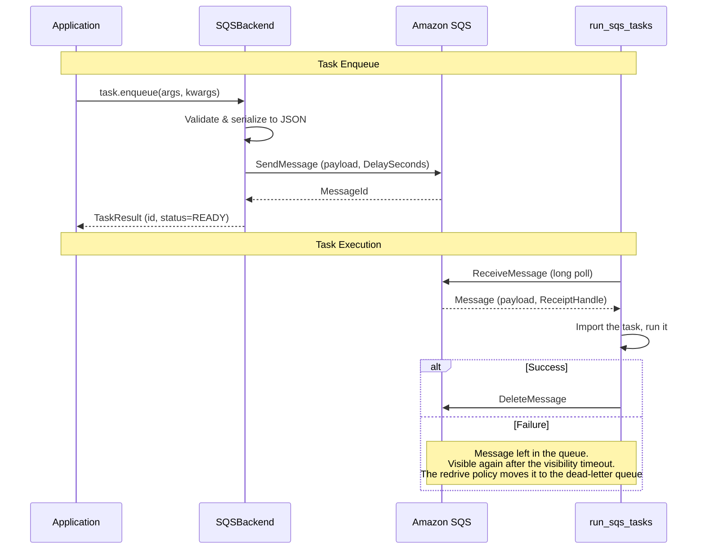

# django-tasks-amazon-sqs

[](https://github.com/tokibito/django-tasks-amazon-sqs/actions/workflows/ci.yml)
[](https://badge.fury.io/py/django-tasks-amazon-sqs)
[](https://pypi.org/project/django-tasks-amazon-sqs/)
[](https://www.djangoproject.com/)
[](https://opensource.org/licenses/MIT)

An Amazon SQS backend for Django 6.0's built-in task framework.

`task.enqueue()` sends the task to an SQS queue as a JSON message carrying
its arguments, and a worker started with `manage.py run_sqs_tasks` receives
the message, runs the task and deletes the message. Nothing is stored in
the database, so the package has no models and no migrations; on the other
hand, results cannot be retrieved after enqueueing.

## Features

- **SQS integration** - A task's `queue_name` is the name of the SQS queue
  it is sent to
- **Pull worker** - `run_sqs_tasks` long polls the queue; nothing calls
  your application, so there is no endpoint to expose
- **Delayed execution** - `run_after` becomes the message's delay, up to
  the 15 minutes SQS allows
- **At-least-once delivery** - A worker that dies leaves its message in the
  queue; SQS hands it over again after the visibility timeout
- **Retries and dead-letter queues** - A failed task's message is left for
  SQS to deliver again, so the queue's redrive policy decides how many
  attempts a task gets and where it ends up
- **Async tasks** - Coroutine tasks are supported
- **Graceful shutdown** - The worker finishes the running task on
  `SIGTERM` or `SIGINT` before exiting

## Architecture



## Requirements

- Python 3.12+
- Django 6.0+
- boto3, installed with the package

## Installation

```bash
pip install django-tasks-amazon-sqs
```

## Quick Start

### 1. Add to INSTALLED_APPS

```python
INSTALLED_APPS = [
    # ...
    "django_tasks_amazon_sqs",
]
```

### 2. Configure the task backend

```python
TASKS = {
    "default": {
        "BACKEND": "django_tasks_amazon_sqs.SQSBackend",
        "QUEUES": [],  # Empty list allows all queue names
        "OPTIONS": {
            # Detected from AWS_REGION / AWS_DEFAULT_REGION when unset
            # "AWS_REGION": "ap-northeast-1",
        },
    },
}
```

> **Note:** `QUEUES` controls which queue names a task may use. If omitted,
> only `"default"` is allowed. Set `QUEUES: []` to allow any name, or list
> the names explicitly.

AWS credentials come from the usual places: the environment, the instance
or task role, or `~/.aws/credentials`. The application needs
`sqs:SendMessage`; the worker needs `sqs:ReceiveMessage`,
`sqs:DeleteMessage` and `sqs:ChangeMessageVisibility`; both need
`sqs:GetQueueUrl` unless `SQS_QUEUE_URL_TEMPLATE` is set.

### 3. Create the queue

```bash
aws sqs create-queue --queue-name default
```

The queue's name is the task's `queue_name`, `default` unless the task
says otherwise. A standard queue; see [FIFO queues](#fifo-queues).

### 4. Define a task

```python
from django.tasks import task


@task
def send_welcome_email(user_id):
    user = User.objects.get(id=user_id)
    # Send email...
    return f"Email sent to {user.email}"
```

### 5. Enqueue the task

```python
result = send_welcome_email.enqueue(user_id=123)
print(f"Task ID: {result.id}")
```

### 6. Run the worker

```bash
python manage.py run_sqs_tasks --continuous
```

## Usage

### JSON-serializable parameters

Task arguments, keyword arguments and return values must be
JSON-serializable, as the task framework requires: `str`, `int`, `float`,
`bool`, `None`, and `dict`, `list` and `tuple` of those. Convert a
`datetime` with `isoformat()`, a `UUID` with `str()`, and a `Decimal` to a
string before enqueueing.

### Delayed execution

```python
from datetime import timedelta
from django.utils import timezone

delayed = my_task.using(run_after=timezone.now() + timedelta(minutes=10))
result = delayed.enqueue()
```

`run_after` becomes the message's `DelaySeconds`. **SQS cannot hold a
message back for longer than 15 minutes**, so a task with a `run_after`
further out raises `InvalidTask`. Lower the limit with `MAX_DELAY_SECONDS`.

### Priority

Task priority is not supported: SQS has no message priority, so a task
that sets `priority` raises `InvalidTask` when it is defined. Put urgent
work on its own queue instead, and run a worker for it.

### Queue-specific tasks

```python
@task(queue_name="emails")
def send_email(to, subject):
    pass
```

```bash
aws sqs create-queue --queue-name emails
python manage.py run_sqs_tasks --queue emails --continuous
```

A worker reads one queue. Run one worker per queue.

### Task with context

```python
@task(takes_context=True)
def task_with_context(context, message):
    return f"Task {context.task_result.id}: {message}"
```

`context.attempt` is always 1: the backend keeps no record of earlier
attempts. The worker logs the message's `ApproximateReceiveCount`, which
is what SQS knows about them.

### Results

`supports_get_result` is `False`. `enqueue()` returns a `TaskResult` in
`READY` with the task id, but `get_result()` and `refresh()` are not
available, since nothing stores the outcome. A task that needs to report
back writes to your own storage.

## Failed tasks, retries and dead-letter queues

A task that raises is logged at `ERROR`, with the traceback in the record
of Django's `django.tasks` logger (see [Logging](#logging)), and its
message is **left in the queue**. SQS makes it visible again when the
visibility timeout expires, and a worker runs it again. A message that
keeps failing is retried until the queue's redrive policy moves it to the
dead-letter queue, so set one:

```bash
aws sqs create-queue --queue-name default-dlq
aws sqs set-queue-attributes --queue-url "$QUEUE_URL" --attributes '{
  "RedrivePolicy": "{\"deadLetterTargetArn\":\"arn:aws:sqs:REGION:ACCOUNT:default-dlq\",\"maxReceiveCount\":\"5\"}"
}'
```

Without a redrive policy a failing task is retried forever. To drop a
failed task's message instead, set `RETRY_FAILED_TASKS` to `False`.

A task whose function cannot be imported (the module was renamed, the
function removed, or the worker runs older code than the process that
enqueued it) is treated the same way, so a worker on the new code can pick
it up during a deploy. A message nothing can run, because its body is not
JSON or lacks a field, is deleted and reported at `ERROR`, since every
attempt would end the same way.

### Visibility timeout

A received message stays hidden from other workers for the queue's
visibility timeout (30 seconds by default). **It has to outlast the longest
task**: a task still running when it expires looks exactly like a dead
worker, and another worker starts it a second time. Set it on the queue,
or per receive with `VISIBILITY_TIMEOUT`.

Delivery is at least once, so task functions should be idempotent.

## Configuration Options

```python
TASKS = {
    "default": {
        "BACKEND": "django_tasks_amazon_sqs.SQSBackend",
        "QUEUES": [],
        "OPTIONS": {
            "AWS_REGION": "ap-northeast-1",
            "SQS_ENDPOINT_URL": None,
            "SQS_QUEUE_URL_TEMPLATE": "https://sqs.ap-northeast-1.amazonaws.com/123456789012/{queue_name}",
            "VISIBILITY_TIMEOUT": None,
            "WAIT_TIME_SECONDS": 20,
            "MAX_DELAY_SECONDS": 900,
            "RETRY_FAILED_TASKS": True,
        },
    },
}
```

| Option | Default | Description |
|--------|---------|-------------|
| `AWS_REGION` | Detected | Region. Read from `AWS_REGION` or `AWS_DEFAULT_REGION` when unset, and left to boto3's own configuration (`~/.aws/config`) otherwise |
| `SQS_ENDPOINT_URL` | `None` | Endpoint override, for [LocalStack](#local-development) or moto |
| `SQS_QUEUE_URL_TEMPLATE` | `None` | Queue URL with a `{queue_name}` placeholder. Set it to skip the `GetQueueUrl` call, which also saves needing `sqs:GetQueueUrl` |
| `VISIBILITY_TIMEOUT` | `None` | Seconds a received message stays hidden, 0 to 43200. Leave unset to use the queue's own setting |
| `WAIT_TIME_SECONDS` | `20` | Long polling wait per receive, 0 to 20 (the SQS limit) |
| `MAX_DELAY_SECONDS` | `900` | Largest `run_after` delay accepted, up to 900 (the SQS limit). A task further out raises `InvalidTask` |
| `RETRY_FAILED_TASKS` | `True` | Leave a failed task's message in the queue for SQS to deliver again. `False` deletes it |

## Management Commands

### run_sqs_tasks

```bash
python manage.py run_sqs_tasks [options]

Options:
  --queue QUEUE_NAME        Queue to receive from (default: default)
  --backend BACKEND_NAME    Backend alias in TASKS (default: default)
  --continuous              Keep waiting when the queue is empty instead of exiting
  --max-tasks N             Exit after this many tasks (0 = no limit)
  --wait-seconds SECS       Long polling wait per receive, at most 20
                            (default: the backend's WAIT_TIME_SECONDS)
  --max-messages N          Messages to receive per call, at most 10 (default: 1)
  --no-graceful-shutdown    Do not install the SIGTERM/SIGINT handlers
```

Without `--continuous` the worker exits the first time a receive brings
nothing back, which suits a cron job or a one-off run. With it the worker
long polls until it is told to stop.

A worker runs one task at a time. Run several processes to run more; each
receives its own messages.

### Graceful shutdown

On `SIGTERM` or `SIGINT` (and Ctrl-Break on Windows) the worker stops
receiving, finishes the task it is running, and exits. Messages it had
received but not started are released so another worker gets them at once.
A second signal exits immediately.

A long polling receive is not interrupted: the worker notices the signal
when it returns, within `WAIT_TIME_SECONDS`. Give the process at least
that long before killing it; a Kubernetes `terminationGracePeriodSeconds`
of the wait plus the longest task is a safe value.

## Running tasks from your own code

The worker loop is a function, for a process that is not a management
command, such as a Lambda handler or a thread of your own:

```python
from django_tasks_amazon_sqs import executor

# Run what is in the queue and return when it is empty
results = executor.process_tasks(queue_name="default")

# Run at most one task
result = executor.process_one_task(wait_seconds=0)

# Run the task one message carries; you received the message yourself
result = executor.process_message(backend, "default", message, worker_id)
```

## Logging

The package logs to the `django_tasks_amazon_sqs` logger: a task that
completes at `INFO`, a task that fails and a message that is discarded at
`ERROR`, and the messages it receives and sends at `DEBUG`.

The traceback of a failed task is in a record of Django's own
`django.tasks` logger: `Task id=... path=... state=FAILED`, at `ERROR`,
with the exception attached. Django's default logging configuration prints
the `django` loggers to the console only when `DEBUG` is on, so in
production that record is dropped unless a handler is attached to it:

```python
LOGGING = {
    "version": 1,
    "disable_existing_loggers": False,
    "handlers": {
        "console": {"class": "logging.StreamHandler"},
    },
    "loggers": {
        "django_tasks_amazon_sqs": {
            "handlers": ["console"],
            "level": "INFO",
        },
        "django.tasks": {
            "handlers": ["console"],
            "level": "INFO",
            "propagate": False,
        },
    },
}
```

## Local Development

Point the backend at [LocalStack](https://localstack.cloud/) or
[moto](https://docs.getmoto.org/en/latest/docs/server_mode.html) with
`SQS_ENDPOINT_URL`:

```bash
docker run -d --rm --name localstack -p 4566:4566 localstack/localstack
aws --endpoint-url http://localhost:4566 sqs create-queue --queue-name default
```

```python
TASKS = {
    "default": {
        "BACKEND": "django_tasks_amazon_sqs.SQSBackend",
        "QUEUES": [],
        "OPTIONS": {
            "AWS_REGION": "us-east-1",
            "SQS_ENDPOINT_URL": "http://localhost:4566",
        },
    },
}
```

LocalStack accepts any credentials, so `AWS_ACCESS_KEY_ID=test` and
`AWS_SECRET_ACCESS_KEY=test` in the environment are enough.

## FIFO queues

FIFO queues are not supported in this release: a message to a `.fifo`
queue needs a message group id, and the queue does not accept a delay per
message. Use a standard queue.

## Contributing

Issues and pull requests are welcome. See [CONTRIBUTING.md](CONTRIBUTING.md)
for how to set up a development environment and what a pull request needs.

## License

MIT License
